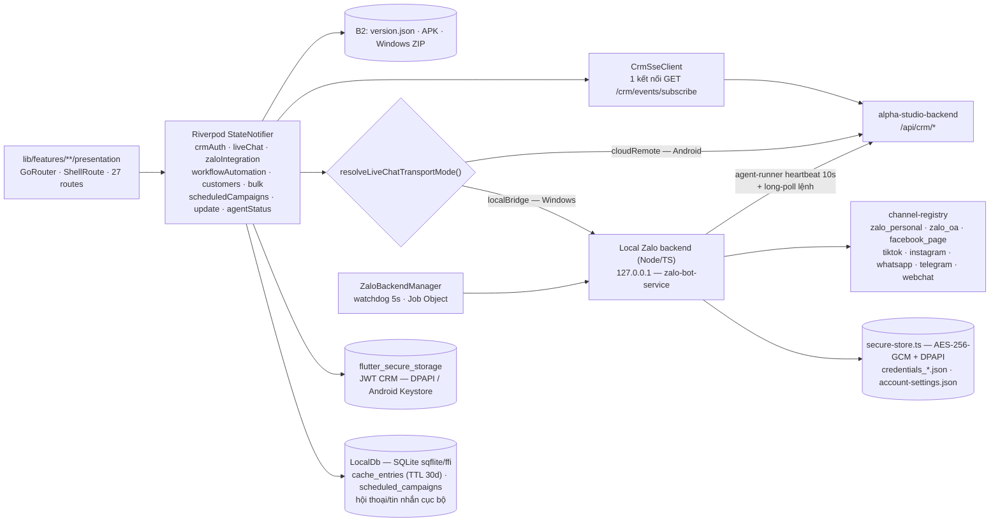

# Project Summary — Alpha CRM

**Last Updated:** 2026-11-22 · **Session:** 17 · **Setup baseline:** 2026-11-22 · **applied:** 2026-11-22 · **mode:** upgrade

> File này phản ánh **trạng thái hiện tại**. Không dùng làm changelog hay bug-fix log — lỗi quan trọng ghi vào `.claude/IMPORTANT_FIXED_BUGS.md`; lỗi vặt không ghi; `.claude/archive/` chỉ mở khi cần biết vì sao một quyết định cũ ra đời.

**Chỉ cập nhật file này khi trạng thái đổi** (cấu trúc file, giả định, phụ thuộc, Known Issues & TODO):

- Dòng `Last Updated` + `Session` mỗi lần sửa file này.
- `Known Issues & TODO`: mục đã xong thì **xoá** (không tick `[x]` rồi để đó — git giữ lịch sử); nếu để lại cơ chế/quyết định còn hiệu lực thì chuyển sang `.claude/CONVENTIONS.md` trước khi xoá.
- `File Structure` / `Secrets & Credentials`: chỉ khi thêm, xoá hoặc đổi file/biến cấu hình.

**Giữ gọn (file này nạp mỗi session):** ô `Notes` của bảng files ≤ ~120 ký tự — nói *cái gì*, không kể từng nút/màu/chi tiết nội bộ. *Cơ chế + vì sao* ⇒ `CONVENTIONS.md`; bẫy ⇒ `IMPORTANT_FIXED_BUGS.md`; chi tiết UI ⇒ không ghi (code + git đã có). Vượt ~30KB ⇒ dọn trước khi thêm.

## 0. Giả định và refresh

| Giả định | Giá trị | Nguồn |
|---|---|---|
| Windows dùng local bridge; Android dùng cloud transport | platform runtime | repository/provider routing |
| SQLite/media local là dữ liệu người dùng | không commit/copy vào repo | local service paths |
| Flutter state giữ kiến trúc provider hiện có | code trong `lib/features/` | project architecture |

| Sau khi | Phải refresh/invalidate | Quên thì bị |
|---|---|---|
| Local DB/message mutation | Provider/notifier và SSE/poll merge | UI cũ, unread sai |
| Đổi local bridge API | Dart client + TypeScript server + tests | desktop runtime gãy |
| Đổi channel/account | Header switcher, model enum, webhook route | kênh kết nối nhưng không dùng được |

## 1. Project Overview

- **Type:** Cross-platform CRM UI application for Android and Windows desktop (Web platform support was fully removed).
- **Tech Stack:** Flutter, Dart SDK 3.10.7, Material 3, Riverpod, GoRouter.
- **Package Manager:** Flutter pub via `pubspec.yaml` + `pubspec.lock`; backend `npm` via `integration/zalo-bot-service/package-lock.json`.
- **Tooling riêng máy:** Python chạy `.claude/guard_check.py` trên máy này là `D:\Dev\conda-envs\py312\python.exe`.
- **i18n:** Vietnamese UI strings inline; `intl` formatting; `flutter_localizations` wired with `locale: Locale('vi')` (24h Material pickers).
- **State Management:** `flutter_riverpod` with `StateNotifierProvider`, `StateProvider`, and local widget state.
- **Styling:** Central design tokens in `lib/app/theme/` plus reusable widgets in `lib/shared/widgets/`.
- **Deployment:** Automated build & release skill in `.agents/skills/build-and-release/` wrapping `alpha-studio-backend/scripts/release-to-b2.js` + GitHub Release & Backblaze B2 upload for Android APK and Windows ZIP (with bundled local Zalo backend + pinned Node LTS runtime).
- **Knowledge Graph:** `.understand-anything/` is not present.

---

## 2. File Structure

### Key Directories

```text
android/                     Native Android runner and Gradle config
docs/                        Design, architecture, agent task, and progress docs
img/                         Reference UI screenshots for the CRM app
lib/
  main.dart                   Flutter entry point
  app/                        App shell, routing, theme, responsive scaffold
  features/                   Feature-first CRM screens and providers
    security/                  Local app lock provider, overlay, and password hashing helpers
    workflows/                 n8n workflow template catalog, automation rules screen, and local backend API client. Email/Facebook settings are now in separate screens with their own routes.
  mock/                       Mock domain models and sample/default data (includes ZaloChannelMode enum)
  shared/                     Reusable widgets and responsive utilities
test/                         Flutter widget tests
windows/                      Native Windows runner and CMake config
integration/
  zalo-bot-service/            Node.js/TypeScript backend bridge — personal-first via zca-js
    src/channels/              Channel adapter pattern (PersonalZca, OfficialOa, Mock)
    src/agent/                 Production outbound agent layer (runner, command executor, agent-identity, cloud-api)
    src/integrations/           n8n settings/client/template builder, n8n event dispatcher, and proxy helper tests/utilities
    src/compliance.ts          Channel-aware backend compliance guard
    src/risk-control-store.ts  Persists client risk-control settings (dataRoot/integrations/risk-control.json) and overlays them onto live config
    src/recent-friend-approvals.ts  TTL tracker of just auto-approved friends; suppresses auto-reply when autoReplyNewFriend=false
    src/config.ts              Environment config with ZaloChannelMode and Agent configs (overridable via risk-control-store)
    src/server.ts              HTTP API server (hardened to bind to 127.0.0.1 and restrict CORS)
    src/personal-login.ts      CLI bootstrap for personal Zalo QR login
    src/zalo.ts                Channel selector/router
docs/
  guides/
    customer-installation-guide.md               Setup quick-start for customers
    production-crm-operator-guide.md             Daily handbook for operators
    zalo-integration-installation-and-usage.md   Detailed setup guide for Zalo integration backend
  compliance/
    zalo-integration-and-risk-controls.md        Comprehensive Vietnamese Zalo risk control strategy
    production-zalo-risk-controls.md             English Zalo risk controls summary checklist
  specs/
    reference-analysis.md                        Comparison of Alpha CRM vs Deplao and ZaloCRM
    implementation-plan.md                       Phased integration plan
    deplao-feature-integration-spec.md           Features integrated from Deplao
    crm-domain-contract-gap.md                   Gap analysis for future domain models
    zalo-message-processing-gap-vs-deplao.md     Zalo Live Chat handling parity audit against Deplao
    sqlite-encryption-at-rest-proposal.md        Proposal for encrypting the message SQLite DBs (SQLCipher vs field-level)
    n8n-facebook-integration-contract.md         Meta Page and n8n webhook routing strategy
    multi-account-channels-plan.md               Multi-account omnichannel integration plan
    chatbotx-feature-analysis.md                 Feature analysis against ChatbotX
    mobile-web-completion-tasklist.md            Detailed gap analysis + task breakdown (BE/AG/FE) for Mobile & Web completion
    mobile-web-completion-qa-checklist.md        QA checklist for Mobile & Web completion
    orca-mobile-adoption-plan.md                 Evaluation (/10) & implementation plan for Orca Mobile companion patterns
    2anh-zalo-bot-integration-plan.md            Scout-and-integrate spec for P1..P10 Zalo personal capabilities from 2anh-zalo-bot
  feature-research-chatwoot-tooljet.md           Feature research from Chatwoot and ToolJet
  api-catalog/
    zalo-reference-sources.md                    Local repo references (zca-js, zalo-bot-js, Deplao)
    zca-js-api-catalog.md                        API catalog for the zca-js library
    zca-js-unintegrated-apis.md                 List of remaining unintegrated zca-js APIs
  releases/
    production-release-checklist.md              Release checklists and verification steps
```

### Critical Files

| File | Purpose | Notes |
|------|---------|-------|
| `.github/workflows/guard.yml` | CI guard check | CI chạy trên mỗi push/PR kiểm tra các symbol rào chắn vẫn còn trong source. |
| `.agents/skills/build-and-release/` | Build & Release skill | Skill + scripts (`build.ps1`, `release.ps1`, `upload-b2.ps1`) đóng gói Windows/Android lên GitHub Release và Backblaze B2. |
| `pubspec.yaml` | Flutter package metadata | Dart SDK ^3.10.7, Riverpod, GoRouter, fl_chart, FFI win32, window_manager, tray_manager. |
| `integration/zalo-bot-service/package.json` | Local backend metadata | `zca-js@^2.3.0` và `proxy-agent@^6.5.0` cho HTTP/HTTPS/SOCKS proxy theo tài khoản. |
| `integration/zalo-bot-service/src/secure-store.ts` | Encryption-at-rest helper | AES-256-GCM qua Windows DPAPI trong `dataRoot/.secure-key`. Chi tiết xem `CONVENTIONS.md`. |
| `analysis_options.yaml` | Analyzer configuration | Includes `package:flutter_lints/flutter.yaml`. |
| `lib/main.dart` | Entry point | Mount `ProviderScope`, `MaterialApp.router`, boot `ZaloBackendManager` non-blocking và status banner. |
| `lib/shared/api/crm_cloud_api.dart` | Alpha Studio cloud API client | Uses `ALPHA_STUDIO_API_URL` with production fallback and Bearer JWT headers. |
| `lib/shared/auth/crm_auth_token_store.dart` | CRM JWT storage abstraction | Direct native import of `token_store_native.dart` (Android/Windows only). |
| `lib/shared/auth/token_store_native.dart` | Native CRM token store | Lưu CRM JWT qua `flutter_secure_storage` (DPAPI / Keystore). Chi tiết xem `CONVENTIONS.md`. |
| `lib/features/auth/providers/crm_auth_provider.dart` | Alpha Studio auth state | Restores/login/logout JWT, fetches `/api/auth/me`, CRM subscription, and quota. |
| `lib/app/routing/app_routes.dart` | Route constants | Defines 27 CRM routes. |
| `lib/app/routing/app_router.dart` | GoRouter tree | Root redirects to `/dashboard`; `ShellRoute` wraps CRM screens. |
| `lib/features/customers/presentation/screens/customers_screen.dart` | Customers workspace | Stats, ViewChipBar, segments, pipeline summary, responsive table, import wizard, AppSidePanel. |
| `lib/features/customers/utils/customer_file_parser.dart` | Customer CSV/XLSX parser | Isolate CSV/XLSX parser + validation (`ImportTargetField`). Chi tiết xem `CONVENTIONS.md`. |
| `lib/features/customers/presentation/widgets/customer_import_wizard.dart` | Interactive import wizard | Hộp thoại nhập CSV/XLSX 3 bước. Chi tiết xem `CONVENTIONS.md`. |
| `lib/features/customers/providers/customers_provider.dart` | Customers state + offline cache | Customers state + cache SQLite 30 ngày qua `LocalDb.putCache` với offline fallback. |
| `lib/shared/local_db/local_db.dart` | Local SQLite (sqflite/ffi) | Cache `putCache`/`getCache` có TTL trên bảng `cache_entries`. Chi tiết xem `CONVENTIONS.md`. |
| `lib/features/dashboard/utils/dashboard_chart_data.dart` | Dashboard chart helpers | Chuẩn hoá số liệu biểu đồ ngày và gộp thống kê local. Chi tiết xem `CONVENTIONS.md`. |
| `lib/app/shell/responsive_scaffold.dart` | Layout switching | Syncs persisted sidebar width/collapse; frames desktop content card on mobile/tablet/desktop. |
| `lib/app/shell/app_sidebar.dart` | Main navigation | Preset A calm neutral rail, monochrome icons, 56px collapse, drag resize (180-350px). |
| `lib/app/shell/app_topbar.dart` | Top frame bar | 48px header with breadcrumbs, Ctrl+K/Cmd+K CommandPalette, account status, theme toggle. |
| `lib/app/shell/command_palette_dialog.dart` | Global command palette | Ctrl+K/Cmd+K modal with quick actions, routes, diacritic-folded CRM record search. |
| `lib/features/security/` | Local app lock feature | App-level lock overlay, local password hash persistence, and sidebar lock trigger. |
| `lib/features/workflows/` | Workflow automation feature | Omnichannel workflows (`/workflows`, FB, TikTok, IG, WhatsApp, Tele, Webchat). Xem `CONVENTIONS.md`. |
| `lib/shared/models/crm_channel.dart` | `CrmChannel` enum | Discriminator (`zaloPersonal`/OA/FB/TikTok/IG/WA/Tele/Webchat/Email). |
| `lib/features/messaging/live_chat/` | Live Chat multi-account | Dropdown gộp Zalo + kênh workflow + gợi ý `@Tên`/`@All`. Chi tiết xem `CONVENTIONS.md`. |
| `lib/features/messaging/live_chat/utils/quick_reply_shortcuts.dart` | Quick reply resolver | Resolves `/1`, `/2`, and named quick template shortcuts for Live Chat sends. |
| `lib/features/messaging/bulk/` | Bulk + scheduled campaigns | Gửi hàng loạt, hẹn giờ queue Timer, `unknownCount`/`aborted_fail_streak`. Xem `CONVENTIONS.md`. |
| `lib/app/theme/app_colors.dart` | Color tokens | Design-system palette and dark-mode WCAG contrast tokens. |
| `lib/app/theme/app_theme_tokens.dart` | Semantic theme extension | `AppThemeTokens` ThemeExtension (Preset A surfaces, ink hierarchy, borders, tints). |
| `lib/app/theme/app_spacing.dart` | Spacing and radius tokens | 4/8/12/16/20/24/32/40/48 scale and radius tokens. |
| `lib/app/theme/app_text_styles.dart` | Typography tokens | Be Vietnam Pro typography tokens via `google_fonts` with System test fallback. |
| `lib/shared/widgets/` | Shared UI primitives | Buttons, cards, inputs, tabs, badges, ViewChipBar, AppSidePanel, update/compliance dialogs. |
| `lib/shared/utils/zalo_backend_manager.dart` | Desktop backend supervisor | Supervisor (watchdog 5s, Job Object, `shutdownGracefully`). Chi tiết xem `CONVENTIONS.md`. |
| `lib/shared/utils/app_logger.dart` | App logger | Ring buffer 300 dòng + file log phiên (giữ 20 file), `reportToBackend` rate-limited. |
| `lib/shared/utils/windows_job_object.dart` | Windows Job Object (FFI) | `KILL_ON_JOB_CLOSE` Job Object để `node.exe` kết thúc theo tiến trình app. |
| `lib/shared/widgets/backend_status_banner.dart` | Backend status banner | `ValueListenableBuilder` theo dõi `ZaloBackendManager.status`. |
| `lib/shared/widgets/backend_splash_overlay.dart` | First-startup splash | Splash khởi động đầu tiên, giữ panel copy log khi backend `failed`. |
| `lib/shared/utils/desktop_window_manager.dart` | Windows window + tray shell | `DesktopShell` (`window_manager` + `tray_manager`): chặn nút X, menu tray, exit gọi `stopBackend`. |
| `lib/shared/widgets/app_close_gate.dart` | X-button confirm dialog | Inline `AppDialog` xác nhận thoát / ẩn xuống tray. Chi tiết xem `CONVENTIONS.md`. |
| `lib/shared/widgets/revocation_gate.dart` | Device-revoked dialog | Inline `AppDialog` khi `deviceRevokedReason` đổi (`reclaimRevokedDevice` / `dismissRevokedDevice`). |
| `lib/features/**/providers/` | Feature state | Riverpod `StateNotifier` classes. |
| `lib/features/subscription/models/subscription_catalog.dart` | Subscription catalog | Đồng bộ bảng giá gói/top-up với backend và parse VietQR checkout. |
| `lib/mock/` | Mock data | Contacts, campaigns, messages, groups, accounts, system settings. |
| `lib/shared/utils/zalo_compliance_guard.dart` | Shared compliance guard | Channel-mode-aware rule engine evaluating risk for all Zalo actions. |
| `lib/shared/utils/app_update_service.dart` | Auto-update service | B2 per-platform release metadata, ZIP/APK download and Windows in-place updater. |
| `lib/shared/widgets/update_result_gate.dart` | Post-update result UI | Gate báo kết quả cập nhật qua `postUpdateResultProvider`. Chi tiết xem `CONVENTIONS.md`. |
| `lib/features/settings/providers/update_provider.dart` | Update state provider | `StateNotifierProvider` quản lý vòng đời check/download/install bản cập nhật. |
| `lib/features/zalo_integration/` | Zalo integration feature | API client, provider (`accountType`, `accountLabel`, `listenerRunning`), data models. |
| `integration/zalo-bot-service/` | Node.js backend | Adapter (`zca-js`/OA/Mock), console tee 5MB, shutdown hooks. Chi tiết xem `CONVENTIONS.md`. |
| `integration/zalo-bot-service/src/integrations/` | Omnichannel settings | Lưu cấu hình n8n, proxy và credentials đa kênh mã hoá at-rest. |
| `integration/zalo-bot-service/src/channels/official-bot-client.ts` | Official Bot transport | Fetch transport gửi tin chính thức qua `ZALO_BOT_TOKEN`. Chi tiết xem `CONVENTIONS.md`. |
| `integration/zalo-bot-service/src/channels/official-oa-channel.ts` | Official OA adapter | Chuẩn hoá trạng thái, gửi text và webhook inbound OA. Chi tiết xem `CONVENTIONS.md`. |
| `integration/zalo-bot-service/src/channels/channel-registry.ts` | Multi-channel registry | `Map<channelKey, ZaloChannel>` cho Zalo, FB, TikTok, IG, WhatsApp, Telegram. |
| `integration/zalo-bot-service/src/channels/facebook-channel.ts` | Facebook adapter | `ZaloChannel` adapter Meta Graph API cho FB Messenger. |
| `integration/zalo-bot-service/src/channels/tiktok-channel.ts` | TikTok adapter (placeholder) | Placeholder TikTok Business Messaging API qua access token. |
| `integration/zalo-bot-service/src/channels/instagram-channel.ts` | Instagram adapter | `ZaloChannel` adapter Meta Graph API cho Instagram Direct Messaging. |
| `integration/zalo-bot-service/src/channels/whatsapp-channel.ts` | WhatsApp adapter | `ZaloChannel` adapter WhatsApp Cloud API qua `phone_number_id`. |
| `integration/zalo-bot-service/src/channels/telegram-channel.ts` | Telegram adapter | `ZaloChannel` adapter Telegram Bot API qua bot token và secret webhook. |
| `integration/zalo-bot-service/src/agent/agent-runner.ts` | Cloud heartbeat/poll loop | Heartbeat 10s (`appVersion`/`agentVersion`), long-poll `/next`. Chi tiết xem `CONVENTIONS.md`. |
| `integration/zalo-bot-service/src/agent/outbound-reporter.ts` | Outbound cloud reporter | Báo tin gửi outbound lên `/crm/agent/events/message` (tránh lặp qua `senderId`). |
| `integration/zalo-bot-service/src/channels/zalo-markdown-formatter.ts` | Zalo Markdown + `@mention` | Parse Markdown sang `TextStyle[]`, chunking và `findMentions`. Chi tiết xem `CONVENTIONS.md`. |
| `integration/zalo-bot-service/src/channels/zalo-media-enricher.ts` | Media enricher + MIME map | Rút metadata media, `hasRealMedia`, `resolveAttachmentMimeType`. Xem `CONVENTIONS.md`. |
| `integration/zalo-bot-service/src/channels/zalo-rate-limiter.ts` | Priority rate limiter | Token-bucket 2 làn (`high`/`normal`) dùng `performance.now()`. Xem `CONVENTIONS.md`. |
| `integration/zalo-bot-service/src/local-chat/vietnamese-fold.ts` | Vietnamese diacritic folder | UDF `zd_fold` cho tìm kiếm SQLite không dấu. Chi tiết xem `CONVENTIONS.md`. |
| `test/customers_screen_test.dart` | Customers regression test | Kiểm thử pipeline summary và panel chi tiết khách hàng. |
| `test/workflow_automation_provider_test.dart` | Workflow regression test | Kiểm thử tuần tự hoá cài đặt kênh, rule state và lọc template. |
| `test/widget_test.dart` | Smoke test | Kiểm thử app shell và route `/dashboard` ban đầu. |
| `lib/features/messaging/live_chat/data/live_chat_contracts.dart` | Bridge contracts | Path builders và helper cho local bridge API (`localFirstLiveChat`). Xem `CONVENTIONS.md`. |
| `lib/features/messaging/live_chat/data/live_chat_transport.dart` | Live Chat transport mode | `resolveLiveChatTransportMode`: `localBridge` (Windows) vs `cloudRemote` (Android/iOS). |
| `lib/shared/api/crm_sse_client.dart` | Cloud SSE client | Singleton `/crm/events/subscribe` (watchdog 20s/65s, generation guard). Xem `CONVENTIONS.md`. |
| `lib/features/messaging/live_chat/data/live_chat_cloud_event_mapper.dart` | Cloud SSE event mapper | Map cloud SSE vocabulary sang bridge vocabulary cho `LiveChatNotifier`. |
| `lib/features/messaging/live_chat/providers/agent_status_provider.dart` | Desktop Agent health | Theo dõi agent health + `CalmStatusReveal` từ cloud SSE ở remote mode. |
| `lib/features/messaging/live_chat/utils/mobile_connection_diagnostics.dart` | Mobile diagnostics | `CalmStatusReveal`, `evaluateAgentVersionCompat` và chẩn đoán 9 mức. Xem `CONVENTIONS.md`. |
| `lib/features/messaging/live_chat/presentation/widgets/mobile_connection_diagnostics_dialog.dart` | Mobile diagnostics dialog | Hộp thoại chẩn đoán kết nối PC/Mobile qua `showStandardDialog`. Xem `CONVENTIONS.md`. |
| `test/crm_sse_client_test.dart`, `test/live_chat_cloud_event_mapper_test.dart`, `test/mobile_connection_diagnostics_test.dart`, `test/agent_status_provider_test.dart`, `test/mobile_connection_diagnostics_dialog_test.dart` | Cloud SSE & mobile tests | Regression suite cho SSE decoder/watchdog/redaction và chẩn đoán kết nối di động. |
| `lib/features/groups/manage/` | Managed groups + AI summary | Tóm tắt AI nhóm (local-first, gộp `groupIdentityKey`, gửi transient không lưu nội dung trên cloud). |

---

## 3. State & Data Dependency Graph



> **Invalidate / refresh rules & hai transport (`localBridge` / `cloudRemote`):** hợp đồng chi tiết 12 quy tắc đã chuyển nguyên văn sang `.claude/CONVENTIONS.md` mục `## Hop dong Invalidate / Refresh & Hai Transport (2026-11-03)`.

---

## 4. Secrets & Credentials

| Thứ | Nơi lưu | Ghi chú |
|---|---|---|
| JWT CRM (Alpha Studio) | `flutter_secure_storage` → Windows DPAPI / Android Keystore (`token_store_native.dart`); bản ghi agent `crm_token.json` & `device-secret.json` mã hoá qua `secure-store.ts` | Đã có migration một lần từ `crm_token.json` plaintext rồi **xoá** file cũ — đừng quay lại lưu plaintext |
| Cookie/credential Zalo cá nhân | `dataRoot/credentials_*.json` — **AES-256-GCM**, khoá 32 byte niêm bằng DPAPI trong `.secure-key` (`secure-store.ts` ghi nguyên tử qua `.tmp` + `renameSync`) | 🔴 **Không re-serialize cookie jar** — byte giải mã phải giống hệt bản gốc để giữ `zpw_sek` bất biến, nếu không phiên Zalo hỏng |
| Token các kênh (FB/IG/WhatsApp/TikTok/Telegram) | `dataRoot/integrations/*` mã hoá at-rest; API trả về dạng **đã che** | Không log token, không trả nguyên giá trị về UI |
| `ZALO_BOT_TOKEN`, cấu hình n8n/proxy | `.env` của `zalo-bot-service` (gitignored) | Bản release **loại trừ** `.env` và `.data` |
| `ALPHA_STUDIO_API_URL` | Biến build, có fallback production | Giá trị public, không phải secret |

- HTTP server của backend cục bộ **bind `127.0.0.1`** và giới hạn CORS — không nới ra `0.0.0.0`.
- App Flutter là client không tin cậy: không nhúng API key của bên thứ ba vào `lib/` hay `assets/`.
- Có đề xuất mã hoá SQLite tin nhắn (`docs/specs/sqlite-encryption-at-rest-proposal.md`) — hiện **chưa** áp dụng, DB tin nhắn cục bộ vẫn là plaintext trên đĩa máy người dùng.

> Chỉ ghi **tên biến và nơi lưu**. Không bao giờ ghi giá trị thật vào file này.

---

## 5. Known Issues & TODO

> 5 hợp đồng đã kiểm chứng (outbound sync, release manifest theo nền tảng, media DNS/redirect, echo guard và CSV/XLSX isolate) cùng quy tắc sửa module Routing/Theme/Shared widgets/Responsive đã chuyển nguyên văn sang `.claude/CONVENTIONS.md` mục `## Chi tiet Co che, Kiem chung & Quy tac Sua Module (2026-11-22)`.

Bản phát hành hiện tại: **v0.4.0+35** trên **GitHub Release** và **Backblaze B2** (ZIP Windows kèm Zalo backend bundle + Node LTS v22.23.2 runtime; APK Android; manifest `version.json` trên `download.giaiphapsangtao.com`). Đã tích hợp giao diện Preset A (Slate), Command Palette (Ctrl+K), Customer Import Wizard, `zca-js@^2.3.0`, AI models `gemini-3.1-flash-lite` & `gemini-3.8-flash` và tính AI Credit theo token thực tế.

Giới hạn đã biết & TODO:
- [ ] Cloud consumer (`alpha-studio-backend/server/routes/crm.js` & `CrmExecutionLog.status`) hiện chỉ có enum `['queued','running','success','failed','cancelled']` nên `status: 'unknown'` do agent gửi khi `SEND_TIMEOUT` bị map về `queued` rồi chuyển sang `cancelled`, và các trường mới (`unknownCount`, `abortedReason`, `inFlightRecipient`) chưa được cloud lưu/hiển thị. Cần bổ sung enum `'unknown'` và hiển thị `abortedReason` ở repo `alpha-studio-backend` trước khi cam kết chống gửi trùng phía cloud cho lượt gửi timeout.
- [ ] Các dòng SQLite `attachments` cũ đã lỡ tạo từ tin nhắn `link` trước bản vá `hasRealMedia` (P6) không tự xoá hồi tố; chỉ các tin nhắn mới được chặn.
- [ ] Smoke giao diện/phiên Zalo thật hoặc APK trên thiết bị Android vật lý khi có thiết bị kiểm thử.
- [ ] Mốc máy dev hiện tại: `flutter analyze` trên Flutter SDK >3.47.0-0.0.pre báo sẵn 100 `info - deprecated_member_use` (`package:flutter/material.dart`).

---

## 6. Quick Commands

```bash
# Development
flutter pub get
flutter run -d windows

# Analysis & Tests
flutter analyze
flutter test

# Guard check (local Python env)
D:\Dev\conda-envs\py312\python.exe .claude\guard_check.py

# Build examples
flutter build apk
flutter build windows
```
